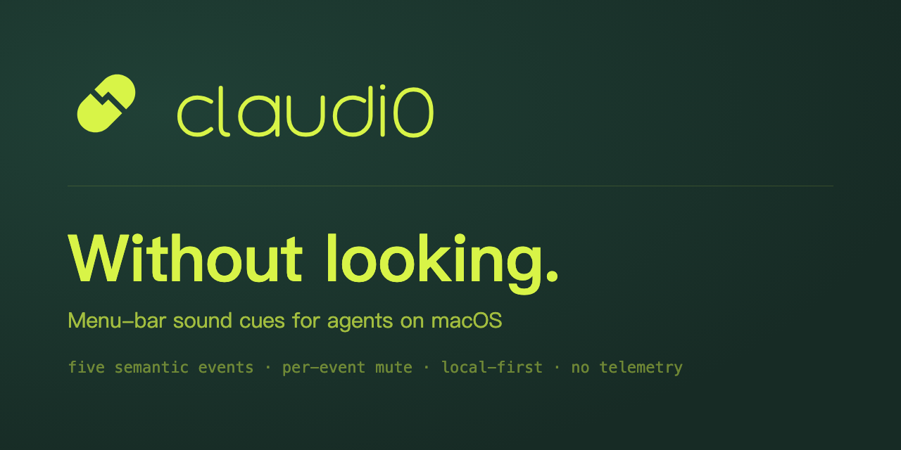

# claudi0

<p align="center">
  <a href="README.md">English</a> ·
  <a href="README.zh-CN.md">简体中文</a>
</p>



<p align="center">
  <a href="https://github.com/d0m999/Claudi0/releases"></a>
  
  
  <a href="LICENSE"></a>
</p>

> **Local-first macOS sound cues for your agents. Know what they are doing without watching the screen.**

<p align="center">
  <b>macOS 12+ · arm64 · local-first · no telemetry</b>
</p>

<p align="center">
  <a href="#install"><b>Install</b></a> ·
  <a href="#the-five-events">Five events</a> ·
  <a href="#connect">Connect</a> ·
  <a href="#built-for-trust">Privacy</a> ·
  <a href="#more">Docs</a> ·
  <a href="#license">License</a>
</p>

An agent works in the background, but somehow you still end up watching it. claudi0 turns five lifecycle events into distinct sounds you can recognise from across the room — so you can leave the desk, make coffee, and know when it needs you.

It sits in the menu bar, never opens a Dock window, and keeps every fact it owns visible: which host is connected, whether a real callback actually arrived, which sound each event maps to, and exactly what it wrote to disk.

## The five events

| Event | Fires when | Default cue |
|---|---|---|
| User initiated | You submit a prompt | `task_start.mp3` |
| Response ended | The agent finishes this turn | `stop.mp3` |
| Execution interrupted | The run stops with a failure | `stop_failure.mp3` |
| Waiting for input | It is waiting on you | `notification.mp3` |
| Subtask ended | A subagent finishes | `subagent_stop.mp3` |

Every event carries its own mute switch, preview button, and candidate sounds. Switch packs per host, workspace, or both.

**Why some agents report `4/5`:** not every agent emits an event for execution interrupted. When one cannot be mapped, claudi0 reports the gap instead of papering over it — the panel says which event is unavailable and why.

## Install

**GitHub Release DMG** is the primary channel:

1. Download `claudi0-<version>.dmg` **and** `SHA256SUMS.txt` from [Releases](https://github.com/d0m999/Claudi0/releases).
2. Verify before opening:

   ```bash
   shasum -a 256 -c SHA256SUMS.txt
   ```

3. Drag `claudi0.app` to `/Applications` and launch it. It is a menu bar app — no Dock window is expected.

Official builds are Developer ID signed, hardened, and notarized. If any signing credential is missing the release workflow fails rather than publishing an ad-hoc build.

**Homebrew** (optional, when enabled for a release):

```bash
brew install --cask d0m999/tap/claudi0
```

Requires macOS 12 Monterey or later on Apple Silicon (`arm64`). Intel Macs are not supported.

## Connect

Opening claudi0 prepares its local runtime under `~/.claudio/`. It does **not** silently modify any agent: connect each one explicitly, from the menu bar panel or from Terminal.

```bash
# list every agent this build can talk to, with the token each one takes
~/.claudio/bin/claudi0 integrations status

~/.claudio/bin/claudi0 integrations connect <host>
~/.claudio/bin/claudi0 integrations disconnect <host>
```

Any agent that runs hooks or loads a plugin bridge can be wired in. Each one is optional and independent — connect one, several, or all of them, and a failure in one never damages or freezes another.

A host counts as active only after a real callback from the current installation produced a receipt; written configuration alone is never enough. Most hook-based agents need one newly submitted prompt for that, and some load their hooks only after a restart or an explicit hooks command. The per-agent detail view always names the outstanding step.

claudi0 appends only its own hook entries, preserves third-party hooks, matchers, array order, and unknown fields, and writes a one-time `.claudio.bak` snapshot before touching a file that already existed.

Disconnect everything you connected before uninstalling so only its own entries are removed.

## Built for trust

- **No network client in the runtime.** No telemetry, analytics, or cloud upload path. Sound Gen only calls the provider you picked, only after you press Generate.
- **Receipts, not guesses.** An event counts as active only after a real callback from the current installation produced a `0600` receipt. Receipts hold an installation ID, host/event IDs, timestamp, and a redacted playback result — never prompts, responses, project paths, or session content.
- **Surgical writes, preserved backups.** Existing hooks and unknown fields survive; backups are pre-first-write snapshots, and a failed host never damages or freezes another.
- **Diagnostics included.** `claudi0 doctor` and the in-app activity page show what the app believes and why.

Full boundary in [PRIVACY.md](PRIVACY.md). Bundled audio keeps its own licenses in [packs/LICENSES.md](packs/LICENSES.md).

## More

| Topic | Where |
|---|---|
| Distribution and Gatekeeper troubleshooting | [docs/distribution.md](docs/distribution.md) |
| Sound pack structure and import format | [docs/pack-standard.md](docs/pack-standard.md), [docs/sound-pack-import-format.md](docs/sound-pack-import-format.md) |
| Build, test, and evidence gates | [CONTRIBUTING.md](CONTRIBUTING.md) |
| Architecture decisions | [docs/adr](docs/adr) |
| Vulnerability reports | [SECURITY.md](SECURITY.md) |

## License

Source is released under the [PolyForm Noncommercial License 1.0.0](LICENSE), © 2026 d0m999: **free for personal and other noncommercial use**; commercial use requires a separate paid license — contact [@d0m999](https://github.com/d0m999/Claudio).

This is a source-available license, **not** an OSI-approved open source license.
