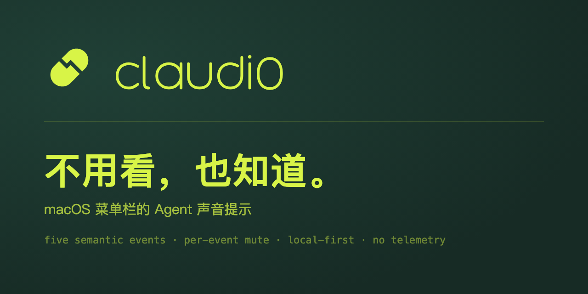

# claudi0

<p align="center">
  <a href="README.md">English</a> ·
  <a href="README.zh-CN.md">简体中文</a>
</p>



<p align="center">
  <a href="https://github.com/d0m999/Claudi0/releases"></a>
  
  
  <a href="LICENSE"></a>
</p>

> **面向 Agent 的本地优先声音提示。不用看屏幕，也知道它们在做什么。**

<p align="center">
  <b>macOS 12+ · arm64 · 本地优先 · 无遥测</b>
</p>

<p align="center">
  <a href="#安装"><b>安装</b></a> ·
  <a href="#五个事件">五个事件</a> ·
  <a href="#连接">连接</a> ·
  <a href="#可信性设计">隐私</a> ·
  <a href="#延伸阅读">文档</a> ·
  <a href="#许可证">许可证</a>
</p>

Agent 在后台跑，结果你还是得盯着屏幕。claudi0 把五个生命周期事件转成五种可以隔着一间屋子分辨出来的声音——你可以离开桌子、去泡杯咖啡，然后在需要你的时候被叫回来。

它常驻菜单栏，不占 Dock 窗口，并且把自己掌握的每一件事都摊开给你看：哪边的宿主连着、有没有真的收到回调、每个事件映射到哪个声音、以及它到底往磁盘上写了什么。

## 五个事件

| 事件 | 触发时机 | 默认音频 |
|---|---|---|
| 用户发起 | 你提交一条提示词 | `task_start.mp3` |
| 响应结束 | 这一轮响应完成 | `stop.mp3` |
| 执行中断 | 运行以失败中止 | `stop_failure.mp3` |
| 等待介入 | 它在等你处理 | `notification.mp3` |
| 子任务结束 | 子 agent 跑完 | `subagent_stop.mp3` |

每个事件都有独立的静音开关、试听按钮和候选音；声音包可以按宿主切换，也可以按工作区单独指定。

**为什么有些 agent 只显示 `4/5`：** 不是每个 agent 都会发出映射到「执行中断」的事件。缺哪个，面板就直说哪个接不上以及原因，不会偷偷补齐。

## 安装

**GitHub Release DMG** 是主安装方式：

1. 从 [Releases](https://github.com/d0m999/Claudi0/releases) 下载同一版本的 `claudi0-<version>.dmg` 与 `SHA256SUMS.txt`。
2. 打开前先校验：

   ```bash
   shasum -a 256 -c SHA256SUMS.txt
   ```

3. 把 `claudi0.app` 拖进 `/Applications` 并启动。它是纯菜单栏 app，不出现 Dock 窗口是正常行为。

正式 Release 经过 Developer ID 签名、hardened runtime 与 Apple 公证；缺少任一签名凭据时 workflow 直接失败，不会降级发布 ad-hoc 构建。

**Homebrew**（可选渠道，某个 Release 启用后可用）：

```bash
brew install --cask d0m999/tap/claudi0
```

需要 macOS 12 Monterey 或更高版本、Apple Silicon（`arm64`）；不支持 Intel Mac。

## 连接

首次打开 claudi0 只会在 `~/.claudio/` 准备本地运行时，**不会**静默改写任何 agent 的配置——每个都要你显式连接，可以在菜单栏面板点「连接」，也可以从 Terminal 完成：

```bash
# 列出这个版本能接的全部 agent，以及各自使用的连接标识
~/.claudio/bin/claudi0 integrations status

~/.claudio/bin/claudi0 integrations connect <host>
~/.claudio/bin/claudi0 integrations disconnect <host>
```

凡是能跑 hook 或加载插件的 agent 都可以接进来。每个都是可选且彼此独立的：可以只连一个，也可以全连；哪一个出问题都不会拖累或冻结其它。

只有当前 installation 收到真实回调并产生回执，才算真正激活——配置写好不等于已激活。多数 hook 型 agent 需要你新提交一次提示词；有些要重启或执行自己的 hooks 命令后才会生效。缺哪一步，面板里的详情页会直接写清楚。

claudi0 只追加自己拥有的 hook 条目：第三方 hook、matcher、数组顺序和未知字段全部保留；首次写入已存在的文件前会生成一次性 `.claudio.bak` 快照。

卸载前把连过的都断开，好让它精准摘除自己的条目。

## 可信性设计

- **运行时没有网络客户端**，没有遥测、分析或云端上传路径。AI 生成声音只在你按下「生成」后，才向你选定的服务商发出明确披露过的请求。
- **看回执，不看猜测。** 只有当前 installation 收到真实回调并写出 `0600` 回执，事件才算激活。回执只含 installation ID、宿主/事件标识、时间和脱敏播放结果——不含提示词、响应正文、项目路径或会话内容。
- **外科式写入，保留现场。** 已有 hook 与未知字段原样保留；备份是首次写入前的快照；一个宿主出问题不会拖累或冻结另一个。
- **自带诊断。** `claudio doctor` 与应用内的活动页会告诉你它判断了什么、依据是什么。

完整边界见 [PRIVACY.md](PRIVACY.md)；随 app 分发的音频另有独立许可，见 [packs/LICENSES.md](packs/LICENSES.md)。

## 延伸阅读

| 主题 | 位置 |
|---|---|
| 分发与 Gatekeeper 排障 | [docs/distribution.md](docs/distribution.md) |
| 声音包结构与导入格式 | [docs/pack-standard.md](docs/pack-standard.md)、[docs/sound-pack-import-format.md](docs/sound-pack-import-format.md) |
| 构建、测试与证据门槛 | [CONTRIBUTING.md](CONTRIBUTING.md) |
| 架构决策记录 | [docs/adr](docs/adr) |
| 安全漏洞报告 | [SECURITY.md](SECURITY.md) |

## 许可证

源代码采用 [PolyForm Noncommercial License 1.0.0](LICENSE)，Copyright © 2026 d0m999：**个人及其它非商用免费**；商用需另行付费授权，请联系 [@d0m999](https://github.com/d0m999/Claudio)。

这是源码可见协议，**不属于** OSI 定义的开源协议。
